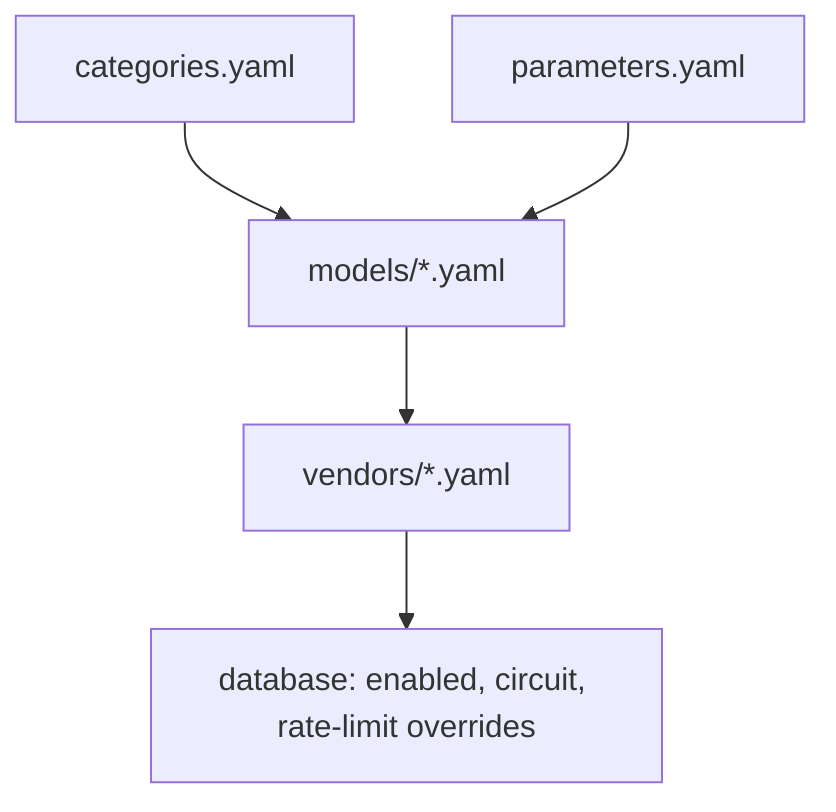

# Catalog

This folder is the shared source of truth for models, categories, parameters, and vendors. Local, rc, and prod load the same definitions. Environment-specific state such as `enabled` lives in the database, not here.

There is no loader yet. Treat every id as if it will become a database primary key. Never rename an id after it has been published.

## Layout

```
catalog/
  README.md                 this file
  categories.yaml           capability groups
  parameters.yaml           app parameter + option vocabulary
  models/
    leading-agent.yaml
    text-to-text.yaml
    text-to-image.yaml
    image-to-image.yaml
    text-to-video.yaml
    image-to-video.yaml
    video-to-video.yaml
    motion-transfer.yaml
    text-to-speech.yaml
    music-generation.yaml
    voice-control.yaml
    lip-sync.yaml
    image-upscaler.yaml
    video-upscaler.yaml
  vendors/
    openrouter.yaml         text gateway
    wavespeed.yaml          media gateway
```

Do not add empty model files for unused categories. A model file exists only when it has entries.

## Layers



- **Category** — what job a model can do (`text-to-image`, `leading-agent`). Defined once in `categories.yaml`.
- **Parameter** — an app-level input (`parameter_resolution`). Defined once in `parameters.yaml`. Options live on the parameter (`option_resolution_1k`).
- **Model** — a stable product we expose. It references categories and a subset of parameters. It does not invent vendor field names.
- **Vendor** — an account that can serve a model. `name` is the account; `adapter` is the implementation. It maps our parameter ids onto that gateway's API names.

`provider` on a model is the origin lab (`openai`, `anthropic`, `google`, `xai`, `bytedance`, `kwaivgi`, `microsoft`, `elevenlabs`, `minimax`, `mureka-ai`, `sonilo`, `sync`, `clarity-ai`). `vendor` is the account we call (`openrouter`, `wavespeed`). Two accounts can share one adapter.

## What belongs in YAML vs the database

| Belongs in YAML                          | Belongs in the database                |
| ---------------------------------------- | -------------------------------------- |
| Model id, name, provider, description    | `enabled` on model, vendor, or binding |
| Context window                           | Per-environment kill switches          |
| Official / WaveSpeed list prices         | Live circuit state                     |
| Allowed parameters and options           | Rate-limit overrides if an env differs |
| Vendor `apiName`, `priority`, param maps |                                        |

Do not put `enabled: false` in YAML to hide a model for one environment.

## IDs

All ids are stable slugs. Changing one is a breaking change.

| Kind      | Pattern                                         | Example                                            | Constraint                                                             |
| --------- | ----------------------------------------------- | -------------------------------------------------- | ---------------------------------------------------------------------- |
| Model     | `{provider}/{product}` or WaveSpeed endpoint id | `openai/gpt-5.4`, `openai/gpt-image-2/edit`        | `<= 50` chars. Becomes `llm_models.id`.                                |
| Category  | kebab-case capability                           | `text-to-image`                                    | Must exist in `categories.yaml`.                                       |
| Parameter | `parameter_{key}`                               | `parameter_resolution`                             | Must exist in `parameters.yaml`.                                       |
| Option    | `option_{key}_{value}`                          | `option_resolution_1k`, `option_aspect_ratio_16_9` | Colons become `_`.                                                     |
| Vendor    | `vendor_{name}`                                 | `vendor_wavespeed`                                 | One file per account. Same adapter can appear on more than one vendor. |

Rules:

- A model id appears in **exactly one** `models/*.yaml` file.
- Every model must be bound in at least one vendor file.
- `allowedValues` on a model must be values that already exist on that parameter's options.
- Do not invent an OpenRouter or WaveSpeed `apiName`. Confirm it against the live catalog first.
- Official Anthropic API ids use hyphens (`claude-opus-5-5`). OpenRouter uses dots (`anthropic/claude-opus-5.5`). Catalog id follows the official hyphen form; vendor `apiName` follows the gateway.

## Categories

[`categories.yaml`](categories.yaml) is the only list. Model files reference those ids; they do not redefine the list.

A model lives in the file that matches its **primary** category. `categories:` may list more than one id later, but do not copy the same model into a second file.

Unused categories (`speech-to-text`, `image-to-text`, `video-to-text`) stay in `categories.yaml` so the vocabulary is complete. Do not create empty model files for them.

## Parameters

[`parameters.yaml`](parameters.yaml) is the app vocabulary. It is provider-agnostic on purpose so a future vendor can reuse the same keys.

Each parameter has:

- `id`, `key`, `label`, `type`, `description`, `xUiComponent`
- `options` when the UI is a select

Allowed `type` values: `string`, `number`, `boolean`, `array<string>`, `array<number>`.

Allowed `xUiComponent` values: `select`, `slider`, `uploader`, `textarea`, `checkbox`.

Do **not** add vendor transport flags here (`enable_sync_mode`, `enable_base64_output`). Those are not product parameters.

When a vendor uses a different field name (`sound` vs `generate_audio`, `size` vs `aspect_ratio`, `end_image` vs `last_image`), keep the app parameter and add a vendor mapping. Do not create a second parameter for the vendor's name.

### Adding a parameter

1. Add it to `parameters.yaml` with a new `parameter_*` id.
2. If it is a select, add every option with a stable `option_*` id. This file stores the **union** of values any model might need.
3. On each model that supports it, add a binding with `allowedValues` / `constraints` / `defaultValue`.
4. On each vendor that sends it, add `parametersMapping` (and `modelParameterOverrides` only when one endpoint differs).

### Adding an option

Add the option to `parameters.yaml` first. Then allow it on the models that accept it. Then add `optionMapping` on vendors that need a different wire value.

Never delete or rename an option id. If a value is retired, stop listing it in `allowedValues` on models.

## Models

One file per populated category. Compact flow mappings are preferred for short rows.

```yaml
- id: openai/gpt-image-2/text-to-image
  name: GPT Image 2
  provider: openai
  description: >
    Routing note for an agent: when to pick this model, what it is worse at,
    and hard limits (duration, refs, quality cost).
  contextWindow: ~
  pricing:
    unit: parameter_table
    rate:
      - { when: { quality: low, resolution: 1k }, usd: 0.01 }
  categories: [text-to-image]
  parameters:
    - { id: parameter_prompt, required: true }
    - {
        id: parameter_resolution,
        required: true,
        defaultValue: 1k,
        allowedValues: [1k, 2k, 4k],
      }
```

### Description

Write it as a routing decision, not marketing. Include when to pick it, when to skip it, duration/reference limits, and which knobs change price. Long-context token surcharges go in the description; the pricing object stays on the standard short-context rate.

### Pricing

| `unit`            | When                    | Shape                                                                                                  |
| ----------------- | ----------------------- | ------------------------------------------------------------------------------------------------------ |
| `per_1m_tokens`   | Text models             | `input`, `output`, `cached_input` in **USD per 1M tokens**. Official list price, not a gateway markup. |
| `per_inference`   | Flat media price        | `rate` in USD.                                                                                         |
| `parameter_table` | Price depends on inputs | `rate: [{ when: { quality, resolution, duration }, usd }]`.                                            |

Text prices come from the provider's official page. Media prices come from WaveSpeed (`wavespeed schema <id>` then `wavespeed price <id> -i ... --json`). If the price API needs a real file and cannot return a table, store WaveSpeed `base_price` as `per_inference` and say so in the description.

`parameter_table` is catalog-only today. `ModelBasePricing` in `apps/api/src/type.ts` does not include it yet. Do not silently drop the table to fit the current TypeScript type.

### Parameters on a model

A model only lists the parameters it accepts:

- `id` — must exist in `parameters.yaml`
- `required`
- `defaultValue`
- `allowedValues` — subset of that parameter's option **values**
- `constraints` — `{ min, max, step }` for sliders; `{ min, max }` item counts for upload arrays

Do not repeat option labels or vendor field names on the model.

### Adding a model

1. Confirm the live id (`wavespeed models` / `wavespeed schema`, or OpenRouter `https://openrouter.ai/api/v1/models`, or the provider pricing page).
2. Check `id` length `<= 50`.
3. Put it in the matching `models/{category}.yaml`.
4. Bind it in the vendor file (`id`, `apiName`, `priority`).
5. For media: copy the allowed parameter subset from the schema; skip transport flags; price the combinations that change cost.
6. For text: use official standard rates; mention long-context multipliers only in the description.

### Removing a model

Delete it from its model file **and** every vendor binding. Do not reuse the old id for a different product.

## Vendors

One file per vendor.

```yaml
id: vendor_wavespeed
name: wavespeed
adapter: wavespeed
kind: media # media | llm
rateLimit: { rpm: 60, burst: 60, maxConcurrency: 10 }
circuitConfig: { cooldownMs: 15000, probeTtlMs: 30000 }
models:
  - {
      id: openai/gpt-image-2/edit,
      apiName: openai/gpt-image-2/edit,
      priority: 80,
    }
parametersMapping:
  parameter_prompt: { vendorParamName: prompt }
  parameter_resolution:
    vendorParamName: resolution
    optionMapping:
      option_resolution_1k: { value: 1k, mappedValue: 1k }
modelParameterOverrides:
  microsoft/mai-image-2.5/text-to-image:
    parameter_aspect_ratio: { vendorParamName: size }
```

- `name` is the account. Two WaveSpeed keys are two vendor files with different names and the same `adapter`.
- `adapter` is the implementation (`wavespeed`, `openrouter`, `vercel-gateway`). Media adapters are registered in the media factory. LLM adapters are registered in `src/features/ai/llm/adapters/factory.ts`.
- `apiName` for WaveSpeed is the full WaveSpeed model id.
- `apiName` for OpenRouter is the OpenRouter model id (`x-ai/grok-4.6`, `anthropic/claude-opus-5.5`). For Vercel AI Gateway it is the gateway model id (`openai/gpt-5.4`).
- Routing tries the lowest `priority` number first. Gateway GPT bindings use 200 so OpenRouter (65–100) is tried first.
- `parametersMapping` is vendor-wide. Use `modelParameterOverrides` only when one endpoint uses a different field.

Current vendors:

- `vendors/openrouter.yaml` — all `leading-agent` and `text-to-text` models
- `vendors/vercel-gateway.yaml` — GPT text models only, fallback after OpenRouter
- `vendors/wavespeed.yaml` — all image, video, and audio media models

## Common update recipes

**New WaveSpeed image/video endpoint**

1. `wavespeed schema <id> --json` and `wavespeed price <id> ... --json`
2. Add the model to the matching `models/*.yaml`
3. Bind it in `vendors/wavespeed.yaml`
4. If the schema introduces a new value (`5k`, `xhigh`), add the option in `parameters.yaml` first
5. If the schema uses a different field name, add a `modelParameterOverrides` entry

**New text model**

1. Confirm official price and context window from the provider site
2. Confirm the OpenRouter id before setting `apiName`
3. Add to `models/leading-agent.yaml` or `models/text-to-text.yaml`
4. Bind it in `vendors/openrouter.yaml`

**New parameter used by several models**

1. Add the parameter (and options) in `parameters.yaml`
2. Bind it on each model
3. Map it on each vendor

**Price change only**

Update `pricing` on the model. Do not change the id.

## YAML pitfalls

- Quote values YAML treats as booleans or null: `none`, `auto`, `on`, `off`, `yes`, `no`.
- Quote aspect ratios (`"16:9"`). Unquoted `16:9` can parse as a sexagesimal number.
- `contextWindow` uses underscores (`1_050_000`) or `~` when the model is not token-priced.
- Keep one `parameters:` key in `parameters.yaml`. A duplicate key silently drops the first list.

## Integrity checks

After any edit, all of these must hold:

1. Every YAML file parses.
2. Every model id is unique and `<= 50` characters.
3. Every `categories:` id exists in `categories.yaml`.
4. Every model parameter id exists in `parameters.yaml`.
5. Every `allowedValues` entry exists on that parameter.
6. Every model is listed in at least one vendor file.
7. Every vendor binding points at an existing model.
8. Media `apiName` values exist on WaveSpeed; text `apiName` values exist on OpenRouter.
   )
   <|eos|>
