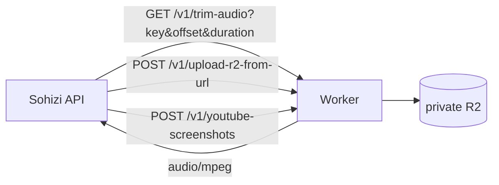

# Sohizi Cloudflare service

Single Cloudflare Worker serving MP3 frame trimming for captioning, R2 URL streaming uploads, and YouTube iframe screenshots.



Video export runs on Remotion Lambda. The Sohizi API calls the Worker
through `CLOUDFLARE_WORKER_URL`.

## Layout

| Path           | Contents                                         |
| -------------- | ------------------------------------------------ |
| `src/index.ts` | Central router and Durable Object export         |
| `src/audio/`   | MP3 frame parsing and the `/v1/trim-audio` route |
| `src/r2/`      | Streaming URL-to-R2 upload handler               |
| `src/youtube/` | Screenshot handler, player page, browser pool    |
| `test/`        | Vitest suites for the Worker routes              |

## API

| Route                                | Behaviour                                                  |
| ------------------------------------ | ---------------------------------------------------------- |
| `GET /v1/trim-audio`                 | Trim an R2 MP3 by `key`, `offset`, `duration`.             |
| `GET /v1/health`                     | Liveness check.                                            |
| `POST /v1/upload-r2-from-url`        | Authenticated streaming upload from an external URL to R2. |
| `GET /v1/youtube-screenshots/player` | Temporary embedding page used by Browser Run.              |
| `POST /v1/youtube-screenshots`       | Authenticated YouTube screenshot capture.                  |

The screenshot route accepts `{ "youtubeUrl": "https://youtu.be/M7lc1UVf-VE?t=90" }`.
An optional integer `seconds` overrides the URL's `t` or `start` parameter.
It returns `{ id, url, requestedSeconds, capturedSeconds }`. Every request
creates a new PNG at `youtube_extractions/{id}.png`; `url` points to that object
through the bucket's public domain. `GET /v1/youtube-screenshots/player` serves
the temporary embedding page used by Browser Run.

## Configuration

| Variable                      | Purpose                                                            |
| ----------------------------- | ------------------------------------------------------------------ |
| `MAX_MP3_BYTES`               | Upper bound for the trim.                                          |
| `R2_BUCKET`                   | Binding for source MP3s and screenshot outputs.                    |
| `BROWSER`                     | Browser Run binding for screenshot capture.                        |
| `CLOUDFLARE_WORKER_TOKEN`     | Secret bearer token shared with the API.                           |
| `R2_PUBLIC_URL`               | Public HTTPS base URL of this environment's R2 bucket.             |
| `YOUTUBE_BROWSER_POOL`        | Durable Object that coordinates the shared browser and tab slots.  |
| `YOUTUBE_SCREENSHOT_MAX_TABS` | Maximum active YouTube tabs in the shared browser; starts at `10`. |

The Sohizi API needs `CLOUDFLARE_WORKER_URL`, the same
`CLOUDFLARE_WORKER_TOKEN`, and a matching `YOUTUBE_SCREENSHOT_MAX_TABS` value.
Sync secrets from `.dev.vars` or `.prod.vars` before deploying:

```bash
bun run secret:dev
bun run deploy:dev
```

Use the environment's R2 public domain. Keep the bearer token server-side; the app browser
calls the authenticated Sohizi API route
`POST /media/:projectId/youtube-screenshot`.
The API admits one active screenshot per user and up to the configured number
of requests across users. The Worker enforces the same tab cap inside its
Durable Object. Extra requests receive `429` with `Retry-After`; there is no
queue. The browser stays available for reuse while each request closes its
own isolated context and tab.

## Local development

```bash
bun run test
bun run typecheck
bun run cf-typegen
```

## Deploy

```bash
bun run deploy:dev
bun run deploy:prod
```
