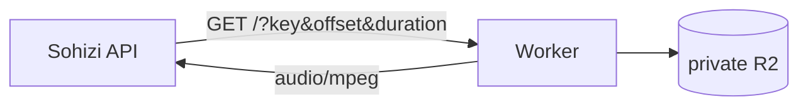

# Sohizi Cloudflare service

MP3 frame-accurate trimming used by captioning.



Video export now runs on Remotion Lambda. This Worker only serves the trim
route that captions still call through `CLOUDFLARE_WORKER_URL`.

## Layout

| Path           | Contents                                   |
| -------------- | ------------------------------------------ |
| `src/index.ts` | Router: health, then audio trim fallback   |
| `src/audio/`   | MP3 frame parsing and the `/` trim handler |
| `test/`        | Vitest suites for the trim route           |

## API

| Route            | Behaviour                                      |
| ---------------- | ---------------------------------------------- |
| `GET /`          | Trim an R2 MP3 by `key`, `offset`, `duration`. |
| `GET /v1/health` | Liveness check.                                |

## Configuration

| Variable        | Purpose                     |
| --------------- | --------------------------- |
| `MAX_MP3_BYTES` | Upper bound for the trim.   |
| `R2_BUCKET`     | Binding for source MP3s.    |

The Sohizi API still needs `CLOUDFLARE_WORKER_URL` for captioning.

## Local development

```bash
bun test
bun run typecheck
```

## Deploy

```bash
bun run deploy:dev
bun run deploy:prod
```
