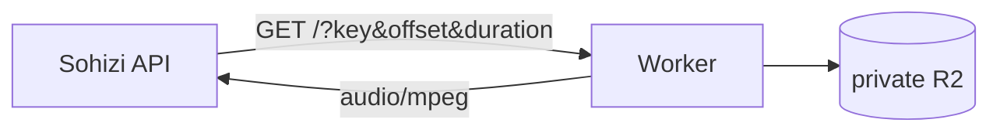

# Sohizi Cloudflare service

MP3 frame trimming for captioning and a separate YouTube iframe screenshot Worker.



Video export runs on Remotion Lambda. The Sohizi API calls the audio Worker
through `CLOUDFLARE_WORKER_URL` and the screenshot Worker through
`YOUTUBE_SCREENSHOT_WORKER_URL`.

## Layout

| Path           | Contents                                   |
| -------------- | ------------------------------------------ |
| `src/index.ts` | Router: health, then audio trim fallback   |
| `src/audio/`   | MP3 frame parsing and the `/` trim handler |
| `src/youtube/` | Separate screenshot Worker, player page, and URL parsing |
| `wrangler.youtube.jsonc` | Dev screenshot Worker with Browser Run and R2 bindings |
| `test/`        | Vitest suites for the trim route           |

## API

| Route            | Behaviour                                      |
| ---------------- | ---------------------------------------------- |
| `GET /`          | Trim an R2 MP3 by `key`, `offset`, `duration`. |
| `GET /v1/health` | Liveness check.                                |
| `POST /v1/youtube-screenshots` | Authenticated screenshot capture on the separate Worker. |

The screenshot route accepts `{ "youtubeUrl": "https://youtu.be/M7lc1UVf-VE?t=90" }`.
An optional integer `seconds` overrides the URL's `t` or `start` parameter.
It returns `{ id, url, requestedSeconds, capturedSeconds }`. Every request
creates a new PNG at `youtube_extractions/{id}.png`; `url` points to that object
through the bucket's public domain. `GET /v1/youtube-screenshots/player` serves
the temporary embedding page used by Browser Run.

## Configuration

| Variable        | Purpose                     |
| --------------- | --------------------------- |
| `MAX_MP3_BYTES` | Upper bound for the trim.   |
| `R2_BUCKET`     | Binding for source MP3s.    |
| `BROWSER` | Browser Run binding on the separate screenshot Worker. |
| `YOUTUBE_SCREENSHOT_TOKEN` | Secret bearer token shared with the API. |
| `R2_PUBLIC_URL` | Public HTTPS base URL of this environment's R2 bucket. |
| `YOUTUBE_BROWSER_POOL` | Durable Object that coordinates the shared browser and tab slots. |
| `YOUTUBE_SCREENSHOT_MAX_TABS` | Maximum active YouTube tabs in the shared browser; starts at `10`. |

The Sohizi API needs `YOUTUBE_SCREENSHOT_WORKER_URL`, the same
`YOUTUBE_SCREENSHOT_TOKEN`, and a matching `YOUTUBE_SCREENSHOT_MAX_TABS` value.
The screenshot Worker has its own Wrangler
configuration so it can be deployed without replacing the existing dev Worker's
Durable Object. Set its secrets before deploying:

```bash
bunx wrangler secret put YOUTUBE_SCREENSHOT_TOKEN --config wrangler.youtube.jsonc
bunx wrangler secret put R2_PUBLIC_URL --config wrangler.youtube.jsonc
bun run deploy:youtube:dev
```

Use the dev R2 public domain. Keep the bearer token server-side; the app browser
calls the authenticated Sohizi API route
`POST /media/:projectId/youtube-screenshot`.
The API admits one active screenshot per user and up to the configured number
of requests across users. The Worker enforces the same tab cap inside its
Durable Object. Extra requests receive `429` with `Retry-After`; there is no
queue. The browser stays available for reuse while each request closes its
own isolated context and tab.

## Local development

```bash
bun test
bun run typecheck
bunx wrangler types youtube-configuration.d.ts --config wrangler.youtube.jsonc --env-interface YoutubeWorkerBindings --include-runtime=false
```

## Deploy

```bash
bun run deploy:dev
bun run deploy:prod
bun run deploy:youtube:dev
```
